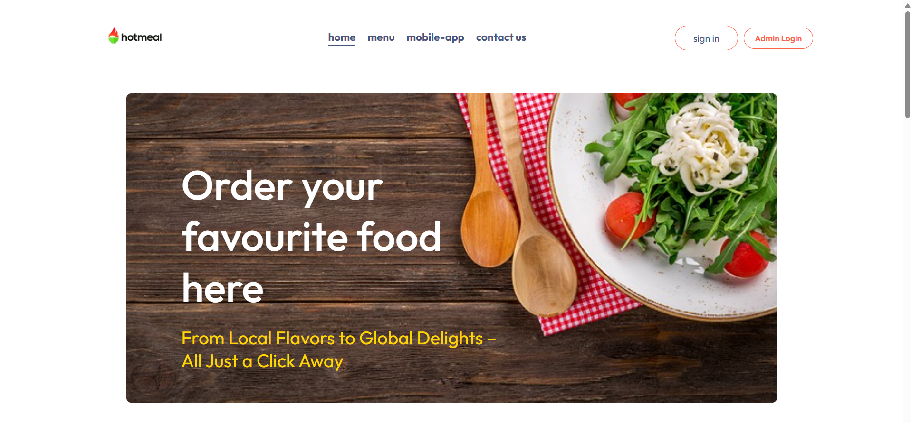
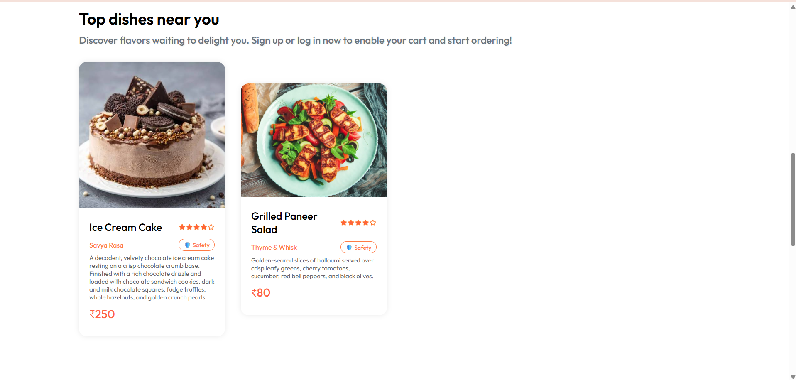

# HotMeal Food Safety Intelligence

A full-stack food delivery application extended with an AI-ready **Restaurant Safety Intelligence** system.

---

## Project Description

**HotMeal Food Safety Intelligence** is a production-oriented food delivery platform built on the MERN stack (MongoDB, Express, React, Node.js). It allows customers to browse food, place orders, and pay via Razorpay. Administrators can manage restaurants, food items, orders, and safety evidence through a dedicated admin panel.

The project is being incrementally extended into a **Restaurant Safety Intelligence** system. The goal is to allow customers to view real-world safety evidence for every restaurant — inspection records, violation notices, certifications, and complaints — sourced from authoritative government open-data sources and displayed on a clean safety timeline.

The system is designed so that **AI analysis comes later**, built on top of real source-derived evidence. The core principle is:




> *Evidence must come from a source. AI may later analyze evidence, but AI must never become the source of evidence.*

---

## Tech Stack

| Layer | Technology |
|---|---|
| Backend | Node.js, Express, MongoDB, Mongoose |
| Frontend (Customer) | React, Vite, React Router, Axios |
| Frontend (Admin) | React, Vite, React Router, Axios |
| Authentication | JWT (role-based: `user` / `admin`) |
| Payment | Razorpay |
| Database | MongoDB (local: `mongodb://127.0.0.1:27017/Food-Delivery`) |

---

## Project Structure

```
HotMeal_Food_Safety/
├── backend/          → Node.js + Express + MongoDB API (port 4000)
├── frontend/         → Customer React app (port 5173)
└── admin/            → Admin React app (port 5174)
```

---

## How to Run

**1. Backend**
```bash
cd backend
npm install
npm run server        # starts on http://localhost:4000
```

**2. Customer Frontend**
```bash
cd frontend
npm install
npm run dev           # starts on http://localhost:5173
```

**3. Admin Frontend**
```bash
cd admin
npm install
npm run dev           # starts on http://localhost:5174
```

**Backend `.env` required fields:**
```
PORT=4000
JWT_SECRET=your_jwt_secret
MONGO_URI=mongodb://127.0.0.1:27017/Food-Delivery
RAZORPAY_KEY_ID=your_razorpay_key_id
RAZORPAY_KEY_SECRET=your_razorpay_key_secret
SAFETY_INGESTION_ENABLED=false
SAFETY_INGESTION_INTERVAL_MINUTES=360
```

---

## Development Progress

### ✅ Core Food Delivery Application

The base HotMeal food delivery application:

- Customer registration and login (JWT)
- Food browsing by category
- Add to cart / remove from cart
- Place order with delivery address
- Razorpay payment integration
- Order tracking (Food Processing → Out for Delivery → Delivered)
- Admin login with role-based access control
- Admin: add / list / delete food items
- Admin: manage orders and update status

---

### ✅ Milestone 4A — Safety Evidence Database

**Commit:** `28a9b03`

- Created `safetyEvidenceModel` with fields: `restaurantId`, `type`, `title`, `description`, `sourceName`, `sourceUrl`, `evidenceDate`, `status`, `severity`
- Full CRUD API: `POST /api/safety-evidence/add`, `GET /api/safety-evidence/list`, `GET /api/safety-evidence/:id`, `POST /api/safety-evidence/remove`
- Admin-only write endpoints protected by `authMiddleware + adminAuth`
- Public read endpoints

---

### ✅ Milestone 4B — Admin Safety Evidence UI

**Commit:** `28a9b03`

- Admin panel page: `SafetyEvidence`
- Add evidence form with restaurant dropdown, type/status/severity selectors
- List all evidence with filter by restaurant
- Delete evidence button with token auth
- Added sidebar link: **Safety Evidence**

---

### ✅ Milestone 4C — Customer Restaurant Safety Page

**Commit:** `d6fb3d4`

- New customer page: `/restaurant/:restaurantId/safety`
- Displays safety evidence for a restaurant
- Safety button (🛡️) on every food card
- Loads from `GET /api/safety-evidence/list?restaurantId=<id>`
- No login required (public endpoint)
- Loading state, empty state, error state

---

### ✅ Milestone 4D — Safety Timeline + Citation UX

**Commit:** `db58878`

- Upgraded customer safety page to a vertical **chronological timeline**
- Client-side sorting: latest evidence first (by `evidenceDate`, fallback to `createdAt`)
- Coloured dots per evidence type on the timeline
- Status and severity badges with colour coding
- Source citations: "View Source ↗" links with `target="_blank" rel="noopener noreferrer"`
- Fallback: when `evidenceDate` is missing, shows `createdAt` with "(record date)" label
- Retry button on API error
- ARIA roles for accessibility
- Responsive: works on desktop, tablet, mobile

---

### ✅ Milestone 5A — Ingestion Foundation

**Commit:** `202651f`

Built the production-oriented evidence ingestion pipeline:

- `safetyEvidenceModel` extended with provenance fields: `sourceType`, `externalRecordId`, `publishedAt`, `retrievedAt`, `contentHash`
- `ingestionRunModel` for audit trail per run
- Pipeline services:
  - `normalizationService` — string/enum/date cleanup
  - `validationService` — required fields + enum validation
  - `restaurantResolver` — conservative name + city matching
  - `deduplicationService` — SHA-256 hash or external ID triple
  - `contentHash` utility
- Local test source adapter (no internet, pipeline testing only)
- Admin-only endpoint: `POST /api/ingestion/run`

---

### ✅ Milestone 5B — Authoritative Safety Sources

**Commit:** `202651f`

Integrated real government open-data sources:

| Source | Authority | API |
|---|---|---|
| Chicago Food Inspections | Chicago CDPH | Socrata SODA (public) |
| NYC DOHMH Inspections | NYC DOHMH | Socrata SODA (public) |
| FSSAI (India) | FSSAI | Disabled — no official public API |

- Source registry: `backend/config/safetySources.js`
- Each adapter maps source-specific fields to the common raw record format
- `rawData` field preserved on each record for auditability
- Conservative restaurant matching: 0 insertions when no matching restaurants in DB (correct behavior)
- Added: `GET /api/ingestion/sources`

---

### ✅ Milestone 5C — Source → Evidence Pipeline

**Commit:** `50aea42`

Production-oriented pipeline with granular result tracking:

| Counter | Meaning |
|---|---|
| `fetched` | Total records from source |
| `inserted` | New evidence records saved |
| `duplicates` | Already in DB (skipped) |
| `unresolved` | No matching HotMeal restaurant |
| `validationFailed` | Missing required fields or bad enum |
| `failed` | Unexpected processing errors |

- `rawData` preservation on adapters (never stored in DB)
- Idempotency verified: running same source twice = 0 insertions on second run

---

### ✅ Milestone 5D — Incremental + Scheduled Ingestion

**Commit:** `caa97cd`

- **Persistent ingestion state** (`ingestionStateModel`): checkpoint, lastSuccessAt, lastError
- **Incremental fetching**: Chicago and NYC adapters accept `sinceDate` → filter API by `inspection_date`
- **MongoDB-based run locking**: prevents concurrent runs for same source (`updateOne + modifiedCount`)
- **Stale lock recovery**: expired locks auto-released on next attempt
- **Checkpoint safety**: checkpoint only advances after successful run; failed runs leave checkpoint unchanged
- **Scheduler**: lightweight `setInterval`, disabled by default (`SAFETY_INGESTION_ENABLED=false`)
- `GET /api/ingestion/status` — operational snapshot
- `GET /api/ingestion/runs` — run history

---

### ✅ Milestone 5E — Ingestion Observability + Reliability

**Commit:** `51dc15b`

Operational observability for the ingestion system:

- `durationMs` field on every run (backend-calculated: `completedAt - startedAt`)
- Structured log line: `[INGESTION] source=X run=Y status=Z fetched=N inserted=N durationMs=Nms`
- `GET /api/ingestion/status` enriched with per-source health:
  - `lastRun`, `lastSuccessfulRun`, `lastFailedRun`
  - `lastAttemptAt`, `lastSuccessAt`, `lastError`
- `GET /api/ingestion/health` — lightweight health check (no external calls)
- `GET /api/ingestion/runs/:id` — single run detail with `processingErrors`
- Runs list: default 20, max 100 results
- `.env.example` added with all configuration documented

---

### ✅ Milestone 5F — Ingestion Admin Dashboard

**Commit:** `420a938`

Admin UI for monitoring and controlling the ingestion system:

- New admin page: `/ingestion` (Ingestion Dashboard)
- **System Overview**: health status, scheduler state, running/idle, stale locks, total runs
- **Source Health**: per-source cards with last attempt, last success, checkpoint, error, lock state
- **Run Ingestion**: source selector dropdown + "Run Ingestion" button (manual trigger only)
- **Run History**: table with all counters (fetched, inserted, duplicates, unresolved, validation failed, duration)
- **Run Detail modal**: full run info including all processing errors with stage + message
- Manual refresh button (no auto-refresh interval)
- Sidebar link added: **Ingestion**

---

## Planned Future Milestones

| Milestone | Description |
|---|---|
| 6 | PostgreSQL + pgvector for vector storage |
| 7 | RAG (Retrieval-Augmented Generation) pipeline |
| 8 | AI Safety Intelligence — LLM analysis of evidence |
| 9 | Guardrails, evaluation, production observability |

---

## Security Notes

- JWT tokens stored in `localStorage`, sent as `token` header (not `Authorization: Bearer`)
- Admin APIs protected by `authMiddleware → adminAuth` (checks `user.role === "admin"`)
- Ingestion APIs are admin-only
- No secrets committed to repository (`.env` is gitignored)
- Conservative restaurant matching: a false negative (missed record) is safer than a false positive (wrong restaurant gets evidence attached)
